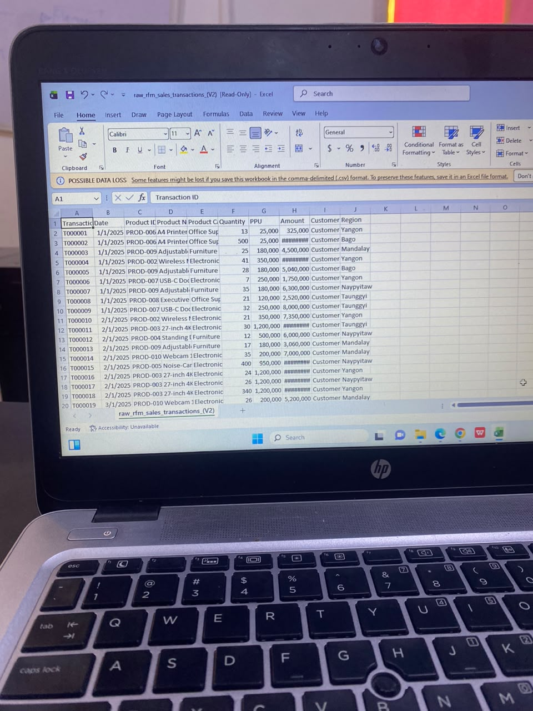
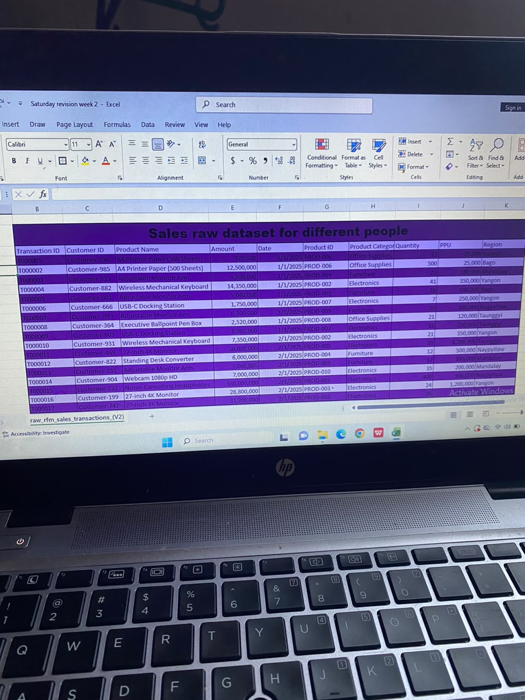

# Sales Data Cleaning & Preparation with Excel
 ## 1. Project Overview
This project is part of my Week 2 Data Analytics learning journey. I worked with a raw sales dataset sourced from Kaggle and cleaned and prepared the data using Microsoft Excel.

## 2. What I Did
* Explored the raw sales dataset
* Identified inconsistencies
* Cleaned and organized the data
* Prepared the dataset for analysis

## 3. Tools Used
*Tool:* Microsoft Excel

## 4. Project Screenshots
### Before Cleaning

### After Cleaning

## 5. Key Learning
This project taught me that good data analysis starts with good data preparation. I learned the importance of checking, cleaning, and organizing raw data before beginning analysis.
